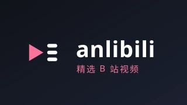

<div align="center">



# anlibv

**把「被网友反复安利的 B 站视频」做成 Android TV 客户端**

[](https://apilevels.com/#:~:text=Jetpack%20Compose%20requires%20a%20minSdk%20of%2021%20or%20higher)
[](./LICENSE)

</div>

---

anlibv 是一个 `Android TV` 客户端：视频列表与分类来自 [anlibili](https://anlibili-site-bxlxh4ai.teamily.run/)，播放器、弹幕、字幕、评论来自上游 [newBV](https://github.com/Frost819/newBV)（fork 关系，见下文）。

安装包标识 `dev.dakai.anlibv`，可以与上游 newBV 同时装在一台电视上。

## 功能

- **精选列表**：11 个频道（推荐 / 新近好评 / AI / 知识 / 编程 / 科技 / 影视 / 运动 / 生活 / 游戏 / 动画），4 列网格，D-Pad 直接操作。
- **每天一次的本地缓存**：启动即预取，当天只用本地数据；菜单键可强制刷新。
- **内容过滤**：内置屏蔽表剔除以政治宣传为主的账号与话术（观察者网、观视频、Nathan Rich 火锅大王、牢A 等），过滤在拉取阶段完成，不会写进缓存。
- **播放器**：Media3，弹幕（**默认关闭**，可随时打开）、字幕、播放速度、画面比例、自定义快捷键、一键三连/点赞/投币/收藏、相关视频连播。
- **个人页**：稍后再看 / 历史 / 收藏（需扫码登录 B 站账号）。
- **设置**：播放、界面（主题/缩放/进度条）、存储清理、编解码信息、日志查看、关于。

## 数据来源

| 项 | 说明 |
|---|---|
| 列表数据 | `https://anlibili-site-bxlxh4ai.teamily.run/videos.json`（整表，约 6.8 MB、1900 条，无分页无鉴权） |
| 分类规则 | 7 个分区 + `AI` / `编程` 两个标签；推荐流为社区条目原序、每 6 条插入 1 条「新近好评」 |
| 播放 | 卡片只带 BV 号，点开时向 B 站 `/x/web-interface/view` 解析 `aid` 后进入播放器 |
| 缓存 | 过滤后的列表写入应用缓存目录，按「文件日期 = 今天」判断是否需要重新拉取 |

屏蔽表在 [`app/src/main/kotlin/dev/frost819/newbv/app/data/anlibili/AnlibiliBlocklist.kt`](app/src/main/kotlin/dev/frost819/newbv/app/data/anlibili/AnlibiliBlocklist.kt)，分「账号」与「关键词」两张表，加一行即可生效；改完需要重新安装（若在同一天内改规则，还需把缓存文件版本号 +1，见 [AGENTS.md](AGENTS.md)）。

## 安装

- 直接使用构建产物：`app/build/outputs/apk/release/anlibv_<versionCode>_<versionName>_release.apk`。
- 或自行构建（见下节）后 `adb install -r`。
- 要求 Android 5.0+（minSdk 21），支持 D-Pad 遥控器，也支持触屏。

```bash
adb connect <TV_IP>:5555
adb install -r app/build/outputs/apk/release/anlibv_*_release.apk
```

## 构建

环境要求：

- JDK 21（AGP 9.1.1）
- Android SDK：compileSdk / targetSdk 36

本地配置（均被 `.gitignore` 忽略）：

```properties
# local.properties
sdk.dir=/path/to/Android/Sdk
```

```properties
# signing.properties（release 必须，否则 APK 无法安装）
releaseStoreFile=key.jks
releaseStorePassword=******
releaseKeyAlias=anlibv
releaseKeyPassword=******
```

构建与检查：

```bash
./gradlew :app:assembleRelease
./gradlew :app:testDebugUnitTest :data:testDebugUnitTest
./gradlew :app:ktlintCheck :data:ktlintCheck :app:detekt
```

图标：`icon.svg`（应用图标）与 `banner.svg`（TV 横幅）是源文件，重新生成各密度资源的命令写在两个 SVG 的文件头注释里。

## 与上游的关系

- 本仓库 fork 自 [`Frost819/newBV`](https://github.com/Frost819/newBV)，后者重构自 [`aaa1115910/bv`](https://github.com/aaa1115910/bv)。
- 上游保留完整 B 站客户端能力（首页推荐、分区、影视、直播、搜索、详情页、UP 主页、追番），本仓库**已删除**这些功能，只保留「anlibili 列表 + 播放 + 个人页」。
- 上游更新**不会**合并进来，而是按主题手工挑补丁（流程见 [AGENTS.md](AGENTS.md) §9）。
- 播放、弹幕、字幕、评论等模块代码仍来自上游，版权与致谢见文末。

## 已知限制

- 「关于」页的"最新版本"显示 `Error`：更新检查指向 `dakai/anlibv`，该仓库暂未发布 Release。
- 追番、视频详情页、UP 主页不存在；卡片长按只有「加/移稍后再看」。
- 内容过滤是账号 + 关键词语义，不做模型判定，新出现的同类账号需要手工加入屏蔽表。
- 列表与个人页均依赖 B 站接口；登录后才能看到历史/收藏/稍后再看。

## 致谢

- [Frost819/newBV](https://github.com/Frost819/newBV) — 播放器与基础设施来源
- [aaa1115910/bv](https://github.com/aaa1115910/bv) — 原始 Android TV 客户端
- [cat3399/blbl](https://github.com/cat3399/blbl) — 部分实现（弹幕分段加载等）参考
- [AkDanmaku](https://github.com/Frost819/AkDanmaku) — 弹幕渲染引擎
- [anlibili](https://anlibili-site-bxlxh4ai.teamily.run/) — 视频列表与网友推荐数据

## License

[MIT](LICENSE) © aaa1115910, Frost819
